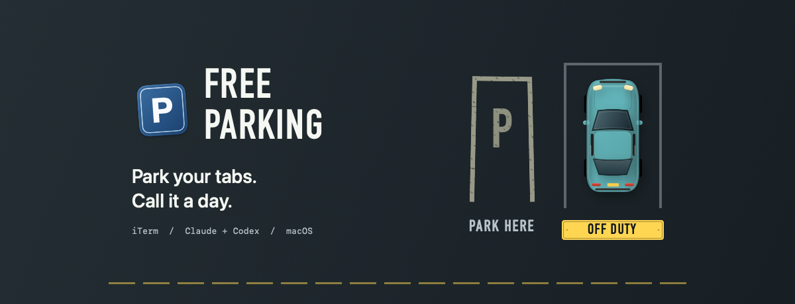

# Free Parking

A local macOS app for putting your **iTerm windows** away and
resuming its Claude, Codex, idle folder and plain `caffeinate` tabs in their original order.

The original parking-lot/car interface in `Sources/FreeParking/` runs on the fresh
subsystem implementation in `Rebuild/`. The legacy backend is kept for comparison
only and is not bundled in the app.

## Build and install

Requires macOS 14+, iTerm2, Xcode Command Line Tools, `/usr/bin/python3`, and
signed-in Claude/Codex CLIs in the login shell. Current live evidence is from
macOS 27.0.1, iTerm2 3.7.3, Claude Code 2.1.296, Codex CLI 0.160.1 and its native
shared daemon 0.162.0. Other versions may expose different native identity data;
unsupported or ambiguous identities are refused, not guessed.

```sh
bash scripts/build-app.sh            # build only
bash scripts/build-app.sh --install  # quit Free Parking first; leave iTerm open
open "/Applications/Free Parking.app"
```

Installation preserves the stable app path and bundle identity for existing Dock
shortcuts. It backs up the previous app under
`~/Library/Application Support/Free Parking/Application Backups/` before replacing
it. Builds are locally signed, not notarized downloads. Automation access to
iTerm is required. Process inspection failures are reported, not treated as an
empty desktop. No accessibility or screen-capture permission is required by the
application.

## Use

1. Click **Park my windows**. Every window's recovery is saved and verified before
   the first interruption or close. Normal iTerm close confirmations remain on.
   An unresolved tab blocks the batch before anything closes.
2. **Review windows** lists every window and its tab names, including exact
   identification problems. You can also park one identified window there.
3. Click a parked car to reopen it. Exact conversation IDs, folders, grouping and
   tab order are verified. Confirmed returns leave the parking lot; recovery stays
   in the archive. Hover over a car to see its saved tab names.
4. The **settings gear** controls whether a task that Free Parking actually
   interrupted receives `please continue` on reopening; the message is editable.
   Idle tasks receive no message. Native agent permissions are not escalated.

Titles are display-only, never identity. Codex subagents sharing a parent's
terminal endpoint are associated through explicit native parent relationships;
unrelated conversations remain ambiguous. Refresh is read-only with respect to
terminals and agents.

No terminal typing, shared-daemon kills, background hooks, or iTerm preference
changes. Split panes, unrelated foreground programs, and ambiguous
agent identities are deliberately not supported. A manually reopened conversation
is not automatically adopted or duplicated. Lost acknowledgements remain pending
rather than risking another launch/message. This is at-most-once launch behavior,
not guaranteed message delivery after every crash.

### Recovery and previous versions

The new journal is private local SQLite under
`~/Library/Application Support/Free Parking/Recovery-v2/`.
Legacy recovery under `~/Library/Application Support/Car Park/` is **unchanged**;
**Garage → Show Previous Recovery Files** opens that folder. Legacy cars are not silently imported or
resolved by title. The backed-up previous app can still access them. Keep these
backups if old parked sessions remain.

## Verification

```sh
python3 -m unittest discover -s Rebuild/tests -v
python3 Rebuild/verify.py --suite all --build
```

The component suites cover the real recovery store, exact identity contracts,
reconciliation, continuation, replay rejection and the independent test guard.
Fake OS tests are not desktop acceptance evidence.

For explicitly authorized live verification, the test-only lab creates **new**
Claude/Codex conversations in random folders and independently protects every
pre-existing window and the runner. Use a fresh directory beneath a trusted
parent; do not bypass a trust screen or denied inspection.

```sh
bash Rebuild/build-test-tools.sh
python3 Rebuild/prove_agents.py --run --directory NEW_PRIVATE_DIRECTORY --cycles 3
```

This checks busy mixed-agent parking, repeated idle cycles, native continuation
counts, cancelled close, settings off and protected window identities. Its
exact-window AX helper handles only the owned fixture's ordinary close sheet;
that helper is **not shipped in the app**. Tests never change iTerm preferences.
The selectable lab is `Rebuild/lab.py`; receipt-proven cleanup is
`Rebuild/cleanup.py`. Private transcripts, screenshots, recovery and live evidence
must never be committed or published.

See [`Rebuild/STATUS.txt`](Rebuild/STATUS.txt) for the component findings and
remaining limitations. Nothing here claims perfection across every future CLI
version, desktop change or crash timing.
